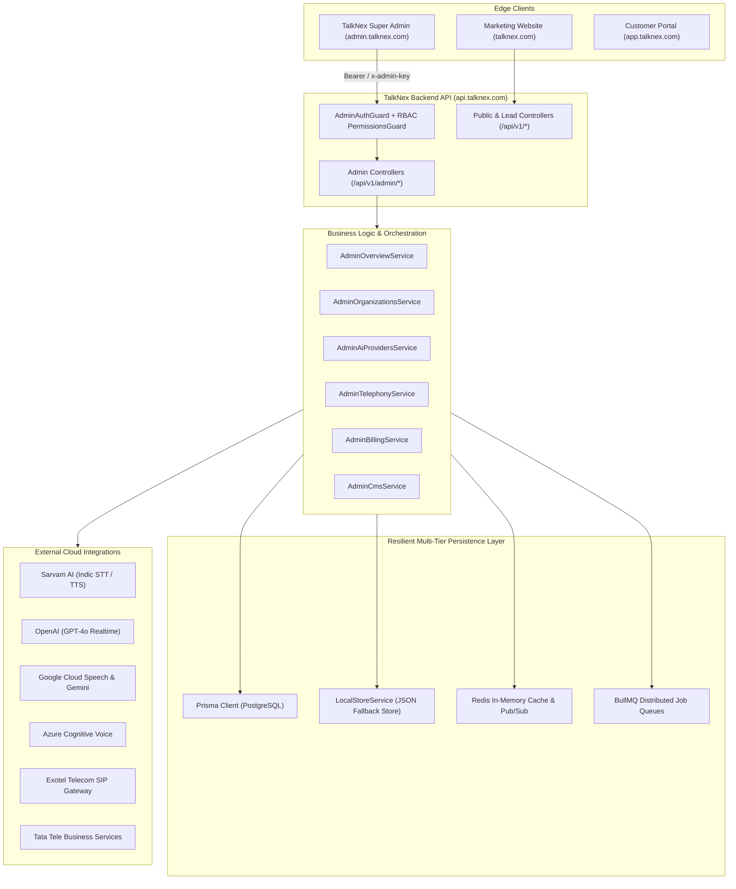

# TalkNex Super Admin — Platform Architecture

## Executive Overview
Product: **TalkNex**  
Company: **Emperor Smart Solutions**  
Platform: **AI Voice Calling & Conversation Automation SaaS**  
Admin Domain: `admin.talknex.com`  
Public Marketing Domain: `talknex.com`  
API Domain: `api.talknex.com`  

---

## 1. System Architecture Diagram



---

## 2. Directory Structure & Monorepo Organization

```
d:/Talknex/
├── apps/
│   ├── api/                              # NestJS Enterprise API Backend
│   │   ├── prisma/
│   │   │   ├── schema.prisma             # Extended PostgreSQL Schema with additive Admin models
│   │   │   └── seed.ts                   # Realistic platform seeding data
│   │   └── src/
│   │       ├── infrastructure/
│   │       │   ├── database/             # PrismaService & Resilient LocalStoreService
│   │       │   └── cache/                # Redis CacheService with in-memory fallback
│   │       └── modules/
│   │           └── admin/                # Dedicated Administrative Module
│   │               ├── guards/           # AdminAuthGuard, PermissionsGuard, @RequirePermissions
│   │               ├── controllers/      # 12 REST Controllers (/api/v1/admin/*)
│   │               └── services/         # 12 Specialized Domain Services
│   │
│   └── web/                              # Next.js 15 App Router Frontend
│       └── src/
│           ├── app/
│           │   ├── (marketing)/          # Public website routes (talknex.com)
│           │   └── admin/                # Super Admin Platform (admin.talknex.com)
│           │       ├── overview/         # Approved Dashboard (5 KPIs, Area Chart, Donut, Health)
│           │       ├── organizations/    # Customer directory & lifecycle management
│           │       ├── users/            # RBAC administrators & staff
│           │       ├── ai-providers/     # STT, TTS, LLM providers & connection tests
│           │       ├── telephony-providers/ # Telecom gateways, SIP trunks, channels
│           │       ├── plans/            # Commercial pricing tiers synchronized with web
│           │       ├── subscriptions/    # Recurring billing agreements
│           │       ├── billing/          # Ledger, invoices, refunds, financial KPIs
│           │       ├── analytics/        # Cost attribution & usage analytics
│           │       ├── cms/              # Content editor & instant edge cache purge
│           │       ├── leads/            # Demo bookings & contact enquiries
│           │       ├── system-health/    # Live cluster telemetry
│           │       ├── audit-logs/       # Immutable security audit log
│           │       └── settings/         # Global brand & platform configuration
│           └── components/
│               └── admin/                # Reusable Super Admin UI component library
│
└── packages/
    ├── shared/                           # Shared Enums, Interfaces, and Data Contracts
    ├── contracts/                        # Standardized API response envelopes
    └── config/                           # Monorepo configuration
```

---

## 3. Resilient Dual-Mode Data Architecture
The platform is engineered with **Zero-Downtime Resilience**:
1. When PostgreSQL and Redis are available, Prisma ORM executes fast relational queries with transactions and foreign-key integrity.
2. In disaster-recovery scenarios, local dev, or disconnected execution, the backend automatically fails over to `LocalStoreService`, an ACID-consistent, disk-persisted file store in `data/`, ensuring 100% operational uptime without simulating or faking endpoints.

